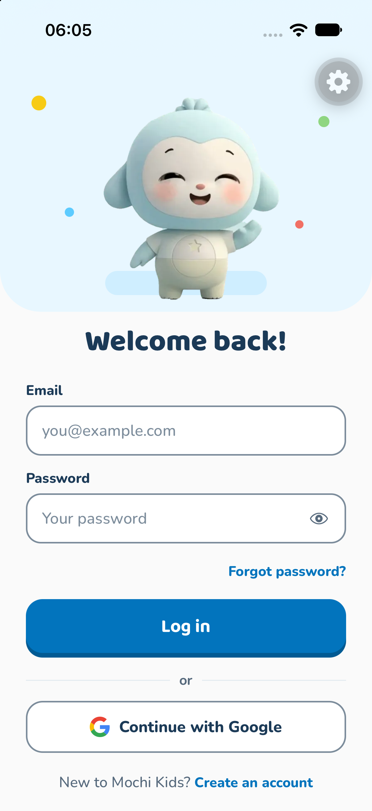
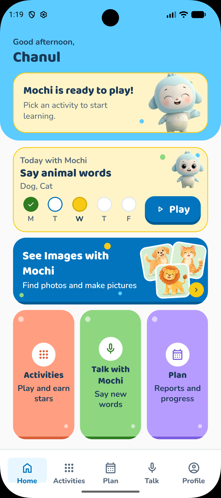
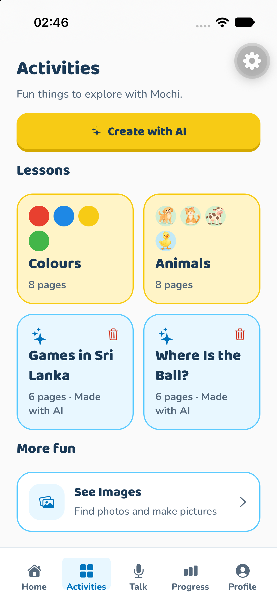
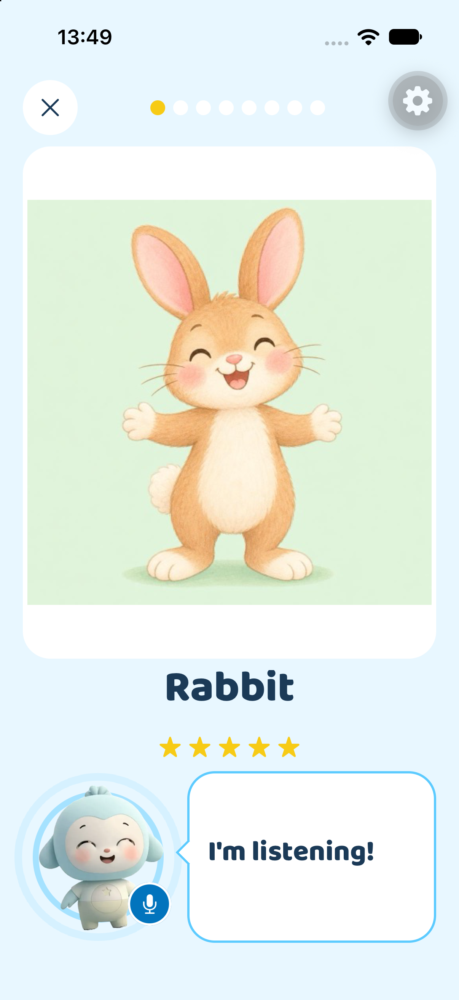
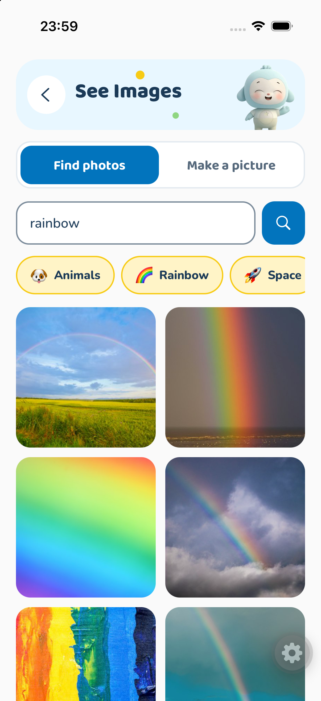
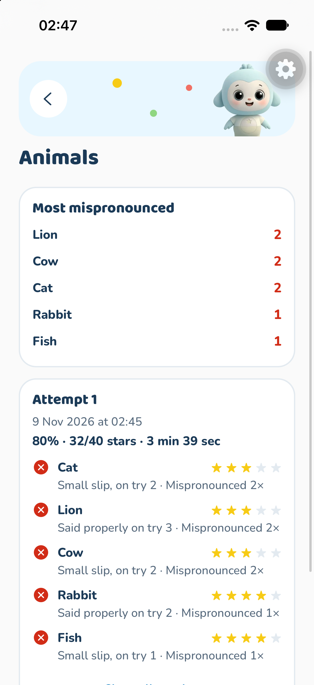

<div align="center">


# Mochi Kids

**A gentle, AI-powered learning app for preschoolers (ages 3–5)**


</div>

<br>







<br>

---

## ✨ What is Mochi Kids?

Mochi Kids helps little ones learn through play: picking answers, saying words out loud and looking at pictures, with Mochi cheering them on.
**Parents** sign up and manage everything. **Children never have accounts**, and the app is built child-safe from the start.

Mochi uses **OpenAI LLMs** behind the scenes to make every child's learning personal:


## 🌈 Features

### 🎮 Activities
- Parents type any topic (*"farm animals"*, *"colours"*) and AI creates an age-appropriate lesson.
- Parents review the lesson before saving it. Nothing is saved until they tap **Save**.
- Kids play by tapping big, colourful choice cards while Mochi reads aloud.
- Stars, confetti and a happy Mochi when they get it right 🎉

### 🗣️ Talk with Mochi
- Mochi says a word and the child repeats it into the microphone.
- AI checks the pronunciation. If a word needs practice, Mochi says it again slowly.
- Mispronounced words are remembered so they can be practised later.
- Voice is only used after parent consent and is **never stored**.

### 🖼️ See Images
- Search real photos (Unsplash) or create AI pictures on any topic.
- Every search goes through a child-safety filter first.
- Save favourite pictures to the device.

### 🧭 Learning Path Agent
- An AI agent looks at each child's scores, history and tricky words every week.
- It writes the parent a friendly **weekly report**.
- It plans the next week's activities and can create new lessons when the child is ready.
- Parents **approve the plan** before anything is created, and get a notification when a new one arrives.

### 📊 Progress & History
- Scores, past attempts and weekly progress bars for each child.
- Multiple children per parent account, each with their own nickname and age band.

### 👨‍👩‍👧 Parent Area
- Email/password and Google sign-in, plus password reset.
- A **parental gate** (a quick sum) keeps grown-up screens away from little fingers.
- Clear consent screens for sign-up, voice and the AI agent.

## 🔒 Built for Kids' Safety

- No ads, no third-party analytics, no external links on kid screens.
- Only a child's **nickname and age band** are collected.
- A child's name or photo is never sent to an AI service.
- All AI calls happen on the **server**. API keys never ship inside the app.
- Each parent can only read and write their own data in Firestore.

## 🛠️ Tech Stack

| Part | Tools |
| --- | --- |
| Mobile app | React Native, Expo, Expo Router, TypeScript |
| Auth & database | Firebase Authentication, Cloud Firestore |
| Backend | Node.js, Express, Firebase Admin |
| AI & images | OpenAI API (`gpt-6-luna`, `gpt-image-2.6-flare`, `gpt-transcribe`, `omni-moderation-latest`), Unsplash API |

## 🚀 Getting Started

### 1. What you need
- [Node.js](https://nodejs.org/) 20.6 or newer
- A phone with [Expo Go](https://expo.dev/go) or a development build (see the note below)
- A [Firebase](https://console.firebase.google.com/) project with **Authentication** (Email/Password, and Google if you want it) and **Firestore** turned on
- An [OpenAI API key](https://platform.openai.com/api-keys)
- An [Unsplash Access Key](https://unsplash.com/oauth/applications)

### 2. Clone and install

```bash
git clone <your-repo-url>
cd mochi-kids-app
npm install
cd server && npm install && cd ..
```

### 3. Add your keys

**App: create `.env` in the project root**

These are Firebase *web* config values (Firebase console → Project settings → Your apps).

```env
# Your computer's Wi-Fi IP + server port, e.g. http://192.168.1.20:3000
EXPO_PUBLIC_API_URL=

EXPO_PUBLIC_FIREBASE_API_KEY=
EXPO_PUBLIC_FIREBASE_AUTH_DOMAIN=
EXPO_PUBLIC_FIREBASE_PROJECT_ID=
EXPO_PUBLIC_FIREBASE_STORAGE_BUCKET=
EXPO_PUBLIC_FIREBASE_MESSAGING_SENDER_ID=
EXPO_PUBLIC_FIREBASE_APP_ID=

# Only needed for Google sign-in
EXPO_PUBLIC_GOOGLE_WEB_CLIENT_ID=
```

> ⚠️ Never put the OpenAI or Unsplash keys in this file. Anything starting with `EXPO_PUBLIC_` is built into the app.

**Server: copy `server/.env.example` to `server/.env`**

```env
OPENAI_API_KEY=
UNSPLASH_ACCESS_KEY=
PORT=3000
GOOGLE_APPLICATION_CREDENTIALS=./service-account.json
# AGENT_TIMER=off   # optional: turns off the automatic weekly plans
```

Then download a service-account key (Firebase console → Project settings → **Service accounts** → *Generate new private key*) and save it as `server/service-account.json`.

> 🔐 `.env`, `server/.env` and `service-account.json` are git-ignored. Keep them that way.

### 4. Run it

Start the server in one terminal:

```bash
cd server
npm run dev
```

Start the app in another terminal:

```bash
npx expo start
```

Scan the QR code with your phone. Your phone and computer must be on the **same Wi-Fi**.

If something looks stale, clear the cache:

```bash
npx expo start -c
```

> 📱 **Expo Go vs development build:** Google sign-in uses native code that Expo Go doesn't include. To use it, make a development build (`npx expo run:ios` / `npx expo run:android`, or EAS Build). Everything else can be tried in Expo Go.
